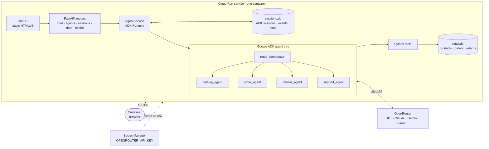
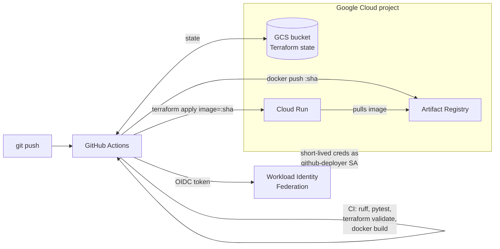
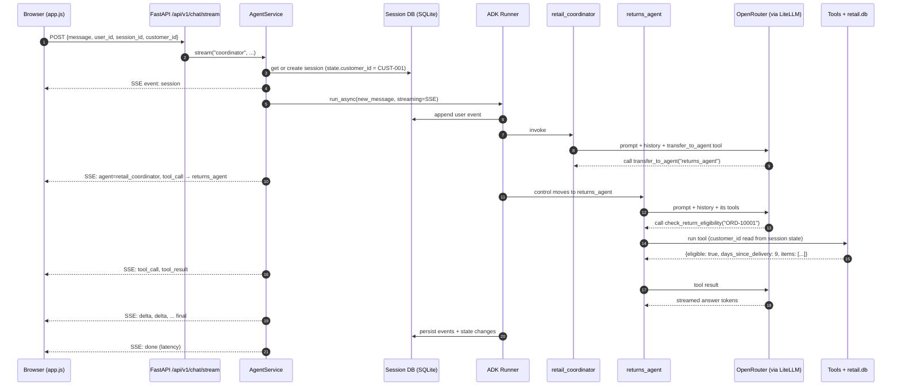
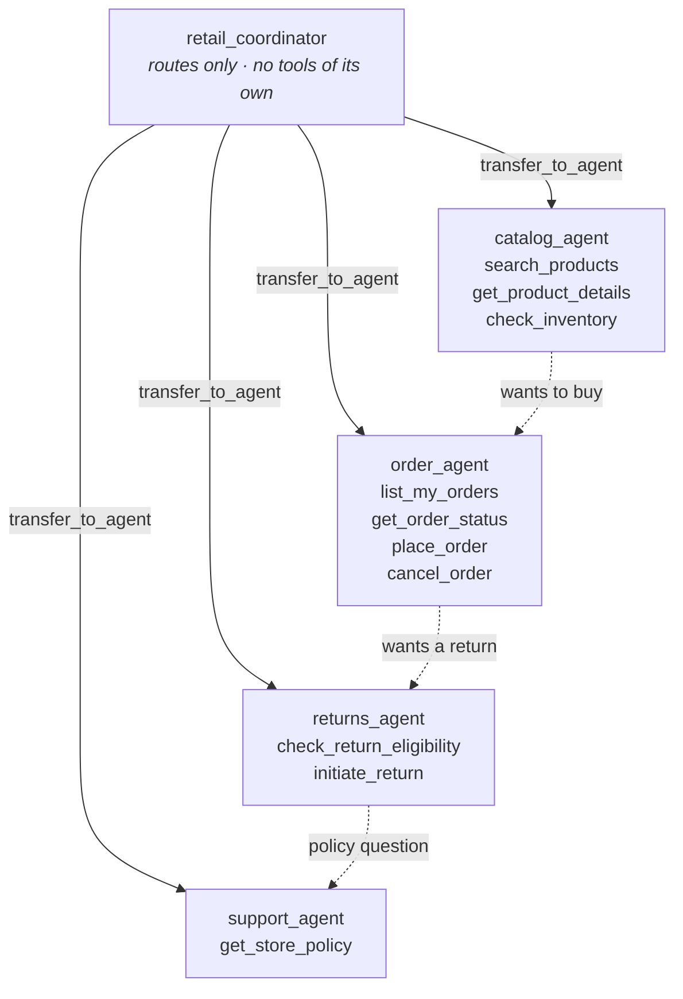
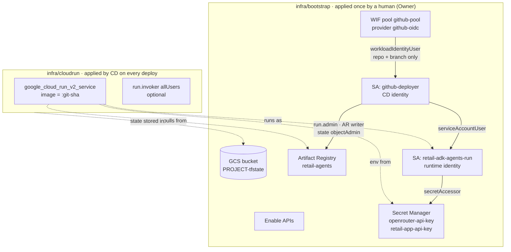
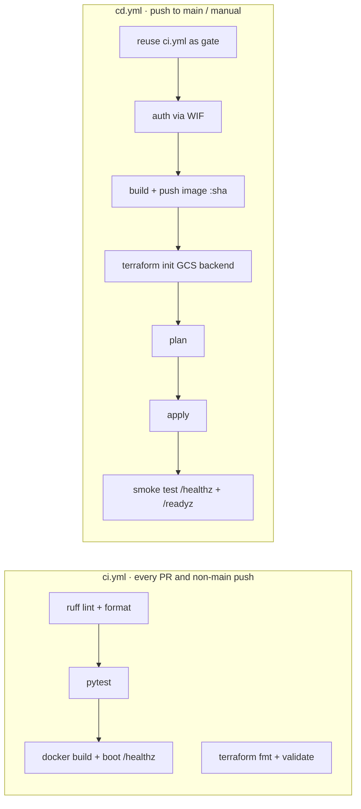

# Retail Multi-Agent Assistant

FastAPI · Google ADK 2.x · OpenRouter (through LiteLLM) · SQLite sessions · Cloud Run · Terraform · GitHub Actions

This repo is a complete retail customer assistant for a made-up store called **Northwind Market**. A customer opens a chat page, asks things like "find me headphones under $300", "where's my order?" or "I want to return this", and a team of agents handles it: a coordinator figures out what the customer wants and hands the conversation to the right specialist, and the specialist uses real tools against a real (SQLite) database to answer or take action.

Everything you need to run it is in here: the API, the agents, the chat UI, the tests, the Docker image, the Terraform for Google Cloud, and the GitHub workflows that test and deploy it on every push to `main`.

The README goes from the bird's-eye view down to the details. Read the first two levels to understand the system, skip to [Run it locally](#run-it-locally) to try it, or jump to [CI/CD setup](#level-8--cicd-setup-step-by-step) when you're ready to deploy.

---

## Contents

- [Level 0 — The bird's-eye view](#level-0--the-birds-eye-view)
- [Level 1 — What's in the repo](#level-1--whats-in-the-repo)
- [Level 2 — Life of a chat message](#level-2--life-of-a-chat-message)
- [Level 3 — The agents](#level-3--the-agents)
- [Level 4 — Sessions and storage](#level-4--sessions-and-storage)
- [Level 5 — The API](#level-5--the-api)
- [Level 6 — The chat UI](#level-6--the-chat-ui)
- [Run it locally](#run-it-locally)
- [Tests](#tests)
- [Level 7 — Infrastructure with Terraform](#level-7--infrastructure-with-terraform)
- [Level 8 — CI/CD setup, step by step](#level-8--cicd-setup-step-by-step)
- [Level 9 — Taking it further in production](#level-9--taking-it-further-in-production)
- [Configuration reference](#configuration-reference)
- [Troubleshooting](#troubleshooting)

---

## Level 0 — The bird's-eye view

One container. Inside it, FastAPI serves both the chat page and the API. The API hands each message to Google ADK, which runs a small tree of agents. The agents think with a model from OpenRouter (any model that supports tool calling) and act through Python tools that read and write the store's database. ADK keeps every conversation in a session database so the agent remembers the thread.



And this is how the code gets there:



Three ideas carry the whole design:

1. **The coordinator never answers retail questions itself.** It routes. Specialists own their domain and their tools. That keeps each prompt short and each agent testable on its own.
2. **Tools are the only way to touch data.** The model never sees SQL and never decides which customer it's talking to. Identity comes from session state that the server sets, so a customer can't talk the agent into showing someone else's orders.
3. **Infrastructure is split in two.** A one-time `bootstrap` stack (APIs, registry, secrets, identities, WIF) is applied by a human. A small `cloudrun` stack is applied by CD on every deploy. The pipeline never needs owner-level permissions.

---

## Level 1 — What's in the repo

```text
retail-adk-agents/
├── app/
│   ├── main.py                  # FastAPI app factory, lifespan (seed DB, build runners), UI route
│   ├── schemas.py               # Pydantic request/response models
│   ├── core/
│   │   ├── config.py            # every setting, read from env / .env
│   │   ├── logging.py           # JSON logs Cloud Logging understands (severity, request_id)
│   │   ├── middleware.py        # request id + access log
│   │   └── security.py          # optional X-API-Key guard
│   ├── agents/
│   │   ├── model.py             # LiteLlm(openrouter/...) factory, test override hook
│   │   ├── prompts.py           # all agent instructions in one place
│   │   ├── specialists.py       # catalog / order / returns / support agent factories
│   │   ├── coordinator.py       # root agent with the four sub-agents
│   │   └── callbacks.py         # input guardrail + tool-call logging
│   ├── tools/
│   │   ├── catalog_tools.py     # search_products, get_product_details, check_inventory
│   │   ├── order_tools.py       # list_my_orders, get_order_status, place_order, cancel_order
│   │   ├── returns_tools.py     # check_return_eligibility, initiate_return (human review > $500)
│   │   └── policy_tools.py      # get_store_policy
│   ├── services/
│   │   └── agent_service.py     # owns ADK Runners + DatabaseSessionService; chat() and stream()
│   ├── routers/
│   │   ├── chat.py              # /api/v1/chat, /api/v1/chat/stream  (coordinator)
│   │   ├── agents.py            # /api/v1/agents/{agent}/chat[/stream] (direct specialist)
│   │   ├── sessions.py          # /api/v1/sessions CRUD + history
│   │   ├── catalog.py           # plain data APIs (no LLM)
│   │   └── health.py            # /healthz, /readyz
│   ├── data/
│   │   ├── db.py                # SQLite schema + connection helper
│   │   └── seed.py              # demo products, customers, orders
│   └── static/                  # the chat UI: index.html, styles.css, app.js
├── tests/
│   ├── fake_llm.py              # scripted model so tests run offline through real ADK
│   ├── test_api.py              # end-to-end: HTTP -> ADK -> tools -> SQLite
│   └── test_tools.py            # tool unit tests
├── infra/
│   ├── bootstrap/               # one-time: APIs, AR, secrets, SAs, WIF, state bucket
│   └── cloudrun/                # per-deploy: the Cloud Run service (GCS backend)
├── .github/workflows/
│   ├── ci.yml                   # lint, test, terraform validate, docker build + boot check
│   └── cd.yml                   # CI gate -> WIF auth -> build/push -> terraform apply -> smoke test
├── Dockerfile                   # multi-stage, non-root, uvicorn on $PORT
├── Makefile
├── requirements.txt / requirements-dev.txt
└── .env.example
```

The layering is deliberate. Routers only speak HTTP. `AgentService` is the only thing that knows ADK exists. Agents only know about tools. Tools only know about the database. You can replace any one layer (say, swap SQLite for a real order-management API) without touching the others.

---

## Level 2 — Life of a chat message

Here's what happens when a customer types *"Can I return the headphones from order ORD-10001?"* in the UI.



A few details worth knowing:

- **Every step is an ADK `Event`.** The user message, each model reply, each tool call, each tool result, each transfer. The runner writes them all to the session DB, which is why a reloaded chat shows its full history and why the next turn has context.
- **Control stays with the specialist.** After the transfer, the next message in the same session goes straight to `returns_agent` until it (or the model) transfers somewhere else. That's how a follow-up like "yes, go ahead" lands in the right place.
- **The non-streaming endpoint (`POST /api/v1/chat`) runs the same loop** and returns one JSON body with the final reply, the agents involved and every tool call. Good for integrations and evals.

---

## Level 3 — The agents

### The tree



### How routing works in ADK

When an `LlmAgent` has `sub_agents`, ADK automatically gives it a `transfer_to_agent` tool and tells the model about each sub-agent using its `description`. So routing quality comes mostly from two places: the descriptions in `specialists.py` and the coordinator's instruction in `prompts.py`. If routing goes wrong, those are the first two things to look at.

Specialists can transfer too: back to their parent, or to a sibling (peer transfer is on by default). That's what makes "show me pour-over kits... ok, buy the Brewmaster one" work without the customer noticing two agents were involved.

### Models

`app/agents/model.py` builds every model through ADK's `LiteLlm` wrapper:

```python
LiteLlm(model="openrouter/openai/gpt-4o-mini", api_key=..., api_base="https://openrouter.ai/api/v1", ...)
```

The `openrouter/` prefix is what tells LiteLLM which provider to use. Everything after it is the OpenRouter model id. The coordinator and the specialists have separate settings (`ROOT_MODEL`, `SPECIALIST_MODEL`), so you can run a stronger router and cheaper specialists, or the other way round. Whatever you pick has to support tool/function calling.

### Tools

Tools are plain Python functions. ADK reads the function name, type hints and docstring to build the schema the model sees, so the docstrings are written for the model. Each tool returns a dict with a `status` key (`success`, `not_found`, `error`) so the model can tell "nothing found" from "something broke" and say something sensible.

Tools that act for a customer take a `tool_context: ToolContext` parameter. ADK fills it in and hides it from the model. The tool reads `tool_context.state["customer_id"]`, which the server put there when the session was created. The model can't change it.

Business rules live in the tools, not the prompts, because prompts are suggestions and code is not:

| Rule | Where |
|---|---|
| Can't oversell: stock is decremented with a conditional `UPDATE ... WHERE stock >= ?` | `place_order` |
| Only `processing` orders can be cancelled; stock goes back | `cancel_order` |
| Returns only for delivered orders inside `RETURN_WINDOW_DAYS` (30) | `check_return_eligibility` |
| Can't return more units than were bought, across multiple returns | `initiate_return` |
| Refunds above `REFUND_AUTO_APPROVE_LIMIT` ($500) become `pending_review` | `initiate_return` |
| Customers only see their own orders | every order/returns tool |

The `pending_review` rule is a simple human-in-the-loop pattern: the agent still creates the return and tells the customer what happens next, but a person approves the money. `GET /api/v1/returns?status=pending_review` lists the queue.

### Callbacks

ADK lets you hook into the agent lifecycle. This project uses three:

- `before_model_callback=input_guardrail` blocks obvious prompt-injection phrases and returns a canned reply without calling the model.
- `before_tool_callback` / `after_tool_callback` log every tool call with its args, status and latency. In Cloud Logging you can filter on `jsonPayload.tool`.

### State

ADK session state is a dict saved with the session. This app uses:

| Key | Set by | Used for |
|---|---|---|
| `customer_id` | server, at session creation | identity for tools |
| `user:customer_id` | server | `user:` keys are shared across all of a user's sessions |
| `last_catalog_reply`, `last_order_reply`, ... | ADK via each agent's `output_key` | other agents / APIs can read the latest specialist answer |
| `last_order_id` | `place_order` | follow-ups like "cancel that" |
| `temp:tool_started_at` | tool callback | `temp:` keys are never persisted |

---

## Level 4 — Sessions and storage

There are two SQLite databases and they have different jobs.

**`sessions.db`** belongs to ADK. `AgentService` creates a `DatabaseSessionService(db_url=SESSION_DB_URL)` and passes it to every `Runner`. ADK creates and manages its own tables (sessions, events, app state, user state). You never write to it directly; you use the session APIs.

**`retail.db`** is the store's system of record: `products`, `customers`, `orders`, `order_items`, `returns`. It's created and seeded with demo data at startup if empty. Order dates are relative to "now" so the return-window demo always works: `ORD-10001` was delivered 9 days ago (returnable), `ORD-10003` 50 days ago (not), `ORD-10005` is a $1,199 laptop (returns go to human review).

Each runner gets its own ADK `app_name` (`retail_assistant`, `retail_assistant_catalog`, ...), so coordinator sessions and direct-specialist sessions never mix.

### The honest part about SQLite on Cloud Run

Cloud Run containers have an in-memory filesystem. A SQLite file there lives as long as that instance does and isn't shared between instances. That's why the Terraform defaults are `max_instances = 1` with session affinity on. It works well for a demo, a POC or an internal tool with modest traffic, and you lose session history when the instance is recycled.

For real production traffic, point `SESSION_DB_URL` at Postgres (Cloud SQL) — ADK's `DatabaseSessionService` takes any SQLAlchemy async URL, e.g. `postgresql+asyncpg://user:pass@/sessions?host=/cloudsql/PROJECT:REGION:INSTANCE` — then raise `max_instances`. Do the same for the retail data (or, more realistically, have the tools call your real catalog and order services). Nothing else in the app changes. See [Level 9](#level-9--taking-it-further-in-production).

---

## Level 5 — The API

Interactive docs are at `/docs` (Swagger) and `/redoc` once the app is running.

| Method | Path | What it does |
|---|---|---|
| GET | `/` | Chat UI |
| GET | `/healthz` | Liveness. Always cheap. Used by Cloud Run probes |
| GET | `/readyz` | Checks both databases; reports whether an LLM key is configured |
| POST | `/api/v1/chat` | One turn with the coordinator, JSON response |
| POST | `/api/v1/chat/stream` | Same, as Server-Sent Events |
| GET | `/api/v1/agents` | Lists agents, their tools and sub-agents |
| POST | `/api/v1/agents/{agent}/chat` | Talk to one specialist directly: `catalog`, `orders`, `returns`, `support` (or `coordinator`) |
| POST | `/api/v1/agents/{agent}/chat/stream` | Same, streaming |
| POST | `/api/v1/sessions` | Create a session (`user_id`, `customer_id`, `agent`) |
| GET | `/api/v1/sessions?user_id=...` | List a user's sessions with titles |
| GET | `/api/v1/sessions/{id}?user_id=...` | Full message history + state |
| DELETE | `/api/v1/sessions/{id}?user_id=...` | Delete a session |
| GET | `/api/v1/products`, `/api/v1/products/{sku}` | Catalog data, no LLM |
| GET | `/api/v1/customers`, `/api/v1/customers/{id}/orders` | Demo customers and their orders |
| GET | `/api/v1/returns?status=pending_review` | Returns, e.g. the human-review queue |

If `APP_API_KEY` is set, everything under `/api/v1` needs an `X-API-Key` header. Health routes and the UI page stay open (the UI asks for the key on the first 401 and keeps it in the browser).

### Examples

```bash
# one turn, JSON
curl -s localhost:8080/api/v1/chat -H 'content-type: application/json' -d '{
  "message": "Show me noise-cancelling headphones under $300",
  "user_id": "demo-user",
  "customer_id": "CUST-001"
}' | jq

# continue the same conversation
curl -s localhost:8080/api/v1/chat -H 'content-type: application/json' -d '{
  "message": "Is it in stock?", "user_id": "demo-user", "session_id": "<session_id from above>"
}' | jq .reply

# straight to the returns specialist
curl -s localhost:8080/api/v1/agents/returns/chat -H 'content-type: application/json' -d '{
  "message": "Can I return order ORD-10001?", "user_id": "demo-user"
}' | jq

# streaming (watch the events arrive)
curl -N localhost:8080/api/v1/chat/stream -H 'content-type: application/json' -d '{
  "message": "Where is my latest order?", "user_id": "demo-user"
}'
```

A JSON chat response looks like:

```json
{
  "session_id": "6f1c...",
  "reply": "Order ORD-10002 shipped 3 days ago with FedEx, tracking 7712 3456 7890...",
  "agents": ["retail_coordinator", "order_agent"],
  "tool_calls": [
    {"agent": "retail_coordinator", "name": "transfer_to_agent", "args": {"agent_name": "order_agent"}},
    {"agent": "order_agent", "name": "list_my_orders", "args": {}},
    {"agent": "order_agent", "name": "get_order_status", "args": {"order_id": "ORD-10002"}}
  ],
  "latency_ms": 3120.4
}
```

### SSE event types

| `type` | Payload | Meaning |
|---|---|---|
| `session` | `session_id` | First event. Save it to continue the thread |
| `agent` | `agent` | A different agent started producing events |
| `tool_call` | `agent`, `name`, `args` | Includes `transfer_to_agent` handoffs |
| `tool_result` | `agent`, `name`, `status` | Tool's `status` field |
| `delta` | `agent`, `text` | Streamed chunk of the answer |
| `final` | `agent`, `text` | Full final answer (replace the deltas with this) |
| `error` | `message` | Timeout, model provider error, etc. |
| `done` | `latency_ms` | Always last |

---

## Level 6 — The chat UI

`app/static/` is three files, no build step. FastAPI serves `index.html` at `/` and the rest from `/static`.

- A random `user_id` is created once and kept in `localStorage`, so a browser keeps its chat list.
- "Signed in as" picks one of the three demo customers. It's stored in the session state when a new chat starts; switching customer starts a new chat.
- Messages go to `/api/v1/chat/stream`. The UI reads the SSE stream with `fetch` + `ReadableStream` (EventSource can't POST), shows which agents and tools ran as small chips above the reply, and renders the answer as it streams.
- The sidebar lists sessions from `/api/v1/sessions` and reloads history from `/api/v1/sessions/{id}`.
- Light and dark mode follow the OS. On phones the sidebar becomes a drawer.

---

## Run it locally

You need Python 3.12+ and an OpenRouter API key (https://openrouter.ai/keys).

```bash
unzip retail-adk-agents.zip && cd retail-adk-agents
python -m venv .venv && source .venv/bin/activate
pip install -r requirements-dev.txt

cp .env.example .env          # then put your key in OPENROUTER_API_KEY
make run                      # = uvicorn app.main:app --reload --port 8080
```

Open http://localhost:8080 and try:

- "Show me something for making coffee under $100"
- "Where's my latest order?" then "Cancel it" (as Daniel Kim, whose order is still processing)
- "I want to return the headphones from ORD-10001, they're too tight"
- As Sofia Rossi: "Return the laptop from ORD-10005, it's defective" (goes to human review)
- "What's your price match policy?"

The databases are created under `./data/`. Delete that folder to start fresh.

### With Docker

```bash
make docker-build
make docker-run               # reads .env, serves on :8080
```

---

## Tests

```bash
make test     # pytest
make lint     # ruff
```

The tests don't need an API key or network. `tests/fake_llm.py` is a small `BaseLlm` subclass that plays the model's part with a script: the coordinator transfers to a specialist based on keywords, the specialist calls its first tool, then answers. Because only the model is fake, the tests exercise the real thing everywhere else: ADK's runner and transfer logic, real tool execution against a temp SQLite DB, `DatabaseSessionService` persistence, the SSE stream, the routers and validation.

What's covered: routing to catalog and returns, the tool-call sequence, session persistence across turns and listing/deleting, streaming event order, direct specialist APIs, input validation, LLM-provider errors mapping to HTTP 502, and the business rules in the tools (customer scoping, overselling, cancellations, return windows, double returns, human review).

---

## Level 7 — Infrastructure with Terraform

Two stacks, on purpose.



**`infra/bootstrap`** creates everything that needs high privileges or only happens once: enabling APIs, the state bucket, the Artifact Registry repo (with cleanup policies), the secret containers, the two service accounts and their roles, and the Workload Identity Federation pool + provider that lets GitHub log in without a JSON key. Secret *values* are deliberately not in Terraform, so they never end up in state. You add them with `gcloud`.

**`infra/cloudrun`** is just the Cloud Run service and its public-invoker binding. CD runs it with the new image tag each time. It uses a GCS backend whose bucket name is passed at `init` time.

Notable Cloud Run settings in `infra/cloudrun/main.tf`:

- `timeout = 300s`: room for multi-step agent turns and long streams.
- `max_instance_request_concurrency = 40`: agent calls spend most of their time waiting on the model, so one instance handles many at once.
- `session_affinity = true` and `max_instances = 1` by default because of SQLite (see Level 4).
- `cpu_idle = true` (pay only while handling requests) and `startup_cpu_boost = true` (faster cold starts).
- Startup and liveness probes on `/healthz`.
- `OPENROUTER_API_KEY` (and optionally `APP_API_KEY`) come from Secret Manager with `version = "latest"`.

---

## Level 8 — CI/CD setup, step by step

### What the pipelines do



CI needs no secrets at all. CD needs no GitHub *secrets* either, only repository *variables*, because it authenticates with Workload Identity Federation: GitHub issues a short-lived OIDC token for the run, Google exchanges it for short-lived credentials as `github-deployer`, and nothing long-lived is stored anywhere. The WIF provider only accepts tokens from your repository **and** the `main` branch.

### What you need before you start

- A GCP project with billing enabled, and an account with Owner on it (only for the one-time bootstrap).
- `gcloud` CLI and Terraform ≥ 1.6 on your machine.
- A GitHub repository for this code.
- An OpenRouter API key.

### Step 1 — Push the code to GitHub

```bash
cd retail-adk-agents
git init && git add . && git commit -m "Initial commit"
git branch -M main
git remote add origin git@github.com:<you>/retail-adk-agents.git
git push -u origin main
```

The first CD run will fail at "Check required variables". That's expected; the next steps fix it.

### Step 2 — Log in to Google Cloud locally

```bash
gcloud auth login
gcloud auth application-default login     # Terraform uses these credentials
gcloud config set project <PROJECT_ID>
```

### Step 3 — Apply the bootstrap stack

```bash
cd infra/bootstrap
cp terraform.tfvars.example terraform.tfvars
# edit: project_id, region, github_repository = "<you>/retail-adk-agents", github_branch = "main"

terraform init
terraform apply
```

It takes a couple of minutes (API enablement is the slow part). When it finishes, `terraform output` prints everything you need for GitHub.

Optional: move the bootstrap state into the bucket it just created, so it isn't only on your laptop. Add `backend "gcs" { prefix = "retail-adk-agents/bootstrap" }` inside the `terraform {}` block in `versions.tf`, then run `terraform init -migrate-state -backend-config="bucket=<PROJECT_ID>-tfstate"`.

### Step 4 — Put the secret values in Secret Manager

```bash
# the OpenRouter key (required)
printf '%s' 'sk-or-v1-...' | gcloud secrets versions add openrouter-api-key --data-file=-

# an app API key (required to exist even if you leave auth off; any random value works)
openssl rand -hex 24 | tr -d '\n' | gcloud secrets versions add retail-app-api-key --data-file=-
```

Use `printf`, not `echo`, so you don't store a trailing newline in the key.

### Step 5 — Add the GitHub repository variables

GitHub → your repo → **Settings → Secrets and variables → Actions → Variables tab → New repository variable**. Values come from `terraform output` in `infra/bootstrap`.

| Variable | Example | Required |
|---|---|---|
| `GCP_PROJECT_ID` | `my-retail-project` | yes |
| `GCP_REGION` | `us-central1` | yes |
| `GCP_WIF_PROVIDER` | `projects/123456789/locations/global/workloadIdentityPools/github-pool/providers/github-oidc` | yes |
| `GCP_DEPLOYER_SA` | `github-deployer@my-retail-project.iam.gserviceaccount.com` | yes |
| `GCP_RUNTIME_SA` | `retail-adk-agents-run@my-retail-project.iam.gserviceaccount.com` | yes |
| `TF_STATE_BUCKET` | `my-retail-project-tfstate` | yes |
| `GAR_REPOSITORY` | `retail-agents` | yes |
| `SERVICE_NAME` | `retail-adk-agents` | no (default shown) |
| `ROOT_MODEL` | `openrouter/anthropic/claude-sonnet-4.5` | no (default `openrouter/openai/gpt-4o-mini`) |
| `SPECIALIST_MODEL` | `openrouter/openai/gpt-4o-mini` | no |
| `REQUIRE_API_KEY` | `true` | no. When `true`, Cloud Run gets `APP_API_KEY` from `retail-app-api-key` and `/api/v1` requires `X-API-Key` |

These are variables, not secrets, because none of them is sensitive: they're resource names. The only real secret (the OpenRouter key) never leaves Google Cloud.

**GitHub secrets needed with this setup: none** (two are needed only if you turn on the optional Docker Hub push below).

### Step 6 — (Recommended) Protect the production environment

The deploy job runs in a GitHub environment called `production`. Under **Settings → Environments → production** you can add required reviewers, so every deploy waits for a click. GitHub creates the environment automatically on the first run if it doesn't exist.

### Step 7 — Deploy

Push anything to `main`, or go to **Actions → CD → Run workflow**. The run will:

1. Run the whole CI workflow as a gate.
2. Authenticate to GCP as `github-deployer` via WIF.
3. Build the image and push `REGION-docker.pkg.dev/PROJECT/retail-agents/retail-adk-agents:<12-char sha>` and `:latest`.
4. `terraform init` against the state bucket, `plan`, `apply` with the new image.
5. Curl `/healthz` and `/readyz` on the new URL until they pass.

The service URL shows up on the run's summary page and on the `production` environment.

### Step 8 — Check it

```bash
URL=$(gcloud run services describe retail-adk-agents --region us-central1 --format='value(status.url)')
curl $URL/readyz
open $URL      # the chat UI
```

Logs: Cloud Console → Cloud Run → retail-adk-agents → Logs. Every line is JSON with `severity`, `request_id`, and for agent work `agent`, `tool`, `session_id`, `latency_ms`.

### Optional: also push the image to Docker Hub

CD can publish the same image to your Docker Hub account next to Artifact Registry, so you can `docker pull` it anywhere, like your existing `anjaiahspr/fast-api`. Cloud Run still deploys from Artifact Registry, which is faster and stays inside your project.

1. **Create the repository on Docker Hub.** hub.docker.com → Repositories → Create → name it `retail-adk-agents`, Public or Private. You can skip this for a public repo; the first push creates it.
2. **Create an access token.** Docker Hub → Account settings → Personal access tokens → Generate. Give it **Read & Write** scope and copy it. Use this token, not your password.
3. **Add to GitHub** (Settings → Secrets and variables → Actions):

   | Kind | Name | Value |
   |---|---|---|
   | Secret | `DOCKERHUB_USERNAME` | `anjaiahspr` |
   | Secret | `DOCKERHUB_TOKEN` | the access token from step 2 |
   | Variable | `DOCKERHUB_REPO` | `anjaiahspr/retail-adk-agents` |

4. Push to `main`. The build step now pushes four tags in one go:

   ```text
   REGION-docker.pkg.dev/PROJECT/retail-agents/retail-adk-agents:<sha>
   REGION-docker.pkg.dev/PROJECT/retail-agents/retail-adk-agents:latest
   docker.io/anjaiahspr/retail-adk-agents:<sha>
   docker.io/anjaiahspr/retail-adk-agents:latest
   ```

5. Pull and run it anywhere:

   ```bash
   docker pull anjaiahspr/retail-adk-agents:latest
   docker run --rm -p 8080:8080 -e OPENROUTER_API_KEY=sk-or-v1-... anjaiahspr/retail-adk-agents:latest
   ```

Leave `DOCKERHUB_REPO` empty to turn Docker Hub off; the login step is skipped automatically.

To push by hand from your laptop instead:

```bash
docker login -u anjaiahspr                                   # paste the access token as the password
make dockerhub-push                                          # pushes anjaiahspr/retail-adk-agents:<git-sha> and :latest
make dockerhub-push DOCKERHUB_REPO=anjaiahspr/fast-api TAG=v2   # or any other repo/tag
```

The image is built for `linux/amd64` on purpose. If you build on an Apple Silicon Mac without `--platform linux/amd64`, you get an arm64 image that Cloud Run (and most servers) can't run.

**Deploying to Cloud Run straight from Docker Hub.** Cloud Run can run a public Docker Hub image directly. Set `image = "docker.io/anjaiahspr/retail-adk-agents:<sha>"` in `infra/cloudrun`. For a private Docker Hub repo, create an Artifact Registry *remote repository* that points at Docker Hub with your token, and deploy through it. Keeping Artifact Registry as the deploy source, as CD does now, avoids Docker Hub pull rate limits and outages affecting your deploys.

### Alternative: a service account key instead of WIF

Only if your organisation can't use WIF. Create a key for `github-deployer`, save the JSON as a GitHub **secret** named `GCP_SA_KEY`, and in `cd.yml` replace the two `workload_identity_provider` / `service_account` lines with `credentials_json: ${{ secrets.GCP_SA_KEY }}`. Keys are long-lived and leak easily, so rotate it and prefer WIF when you can.

### Rolling back

Every image is tagged with its commit SHA. Quickest rollback is in the console (Cloud Run → Revisions → send 100% traffic to the previous one). The Terraform-consistent way is to revert the commit on `main` and let CD redeploy.

---

## Level 9 — Taking it further in production

The code is structured so each of these is a contained change:

- **Shared session storage.** Create a Cloud SQL Postgres instance, add `asyncpg` to `requirements.txt`, set `SESSION_DB_URL=postgresql+asyncpg://...` (via Secret Manager), add the Cloud SQL volume/connection in `infra/cloudrun/main.tf`, then raise `max_instances`.
- **Real retail systems.** Replace the SQLite queries inside `app/tools/*` with calls to your catalog, OMS and returns services. Keep the dict-with-`status` return shape and the customer-from-state rule.
- **Real authentication.** Put Identity-Aware Proxy or your API gateway in front, then derive `user_id`/`customer_id` from the verified identity in the router instead of trusting the request body.
- **Policy RAG.** `get_store_policy` is a dict lookup. Swap it for a retriever over your actual policy documents.
- **Stronger guardrails.** The keyword guardrail is a starting point. Add a moderation model call in `before_model_callback` and output checks in `after_model_callback`.
- **Observability.** ADK emits OpenTelemetry spans; export them to Cloud Trace to see each agent, model call and tool as a trace. Add LiteLLM callbacks for token and cost tracking.
- **Evaluation.** The direct specialist endpoints make it easy to run a fixed question set against one agent and score answers and tool choices before each release. ADK also has its own eval tooling.
- **Rate limiting and cost control.** Cap requests per user at the gateway, and set per-key spending limits in OpenRouter.

---

## Configuration reference

All settings are environment variables (or `.env` locally). Defined in `app/core/config.py`.

| Variable | Default | Notes |
|---|---|---|
| `OPENROUTER_API_KEY` | — | Required for chat. From Secret Manager on Cloud Run |
| `ROOT_MODEL` | `openrouter/openai/gpt-4o-mini` | Coordinator model (LiteLLM string) |
| `SPECIALIST_MODEL` | `openrouter/openai/gpt-4o-mini` | Specialists' model |
| `OPENROUTER_API_BASE` | `https://openrouter.ai/api/v1` | |
| `LLM_TEMPERATURE` | `0.2` | |
| `LLM_MAX_TOKENS` | `1024` | |
| `LLM_TIMEOUT_S` | `60` | Per model call; LiteLLM retries twice |
| `AGENT_RUN_TIMEOUT_S` | `120` | Whole turn, all agents and tools |
| `SESSION_DB_URL` | `sqlite+aiosqlite:///./data/sessions.db` | Any SQLAlchemy async URL |
| `RETAIL_DB_PATH` | `./data/retail.db` | |
| `SEED_DEMO_DATA` | `true` | Seed if the DB is empty |
| `APP_API_KEY` | empty | If set, `/api/v1/*` requires `X-API-Key` |
| `APP_ENV` | `local` | Shown in `/healthz` |
| `LOG_LEVEL` | `INFO` | |
| `LOG_JSON` | `true` | `false` for readable local logs |
| `CORS_ORIGINS` | `["*"]` | JSON list |
| `REFUND_AUTO_APPROVE_LIMIT` | `500` | Above this, returns go to human review |
| `RETURN_WINDOW_DAYS` | `30` | |

---

## Troubleshooting

| Symptom | Likely cause / fix |
|---|---|
| Chat returns **502** "LLM provider error" | Bad or missing `OPENROUTER_API_KEY`, no credit on the key, or a model id that doesn't exist. Check `/readyz` → `llm_key_configured`, and the logs for the LiteLLM error |
| The agent replies but never uses tools | The model doesn't support tool calling well. Try `openai/gpt-4o-mini`, `anthropic/claude-*` or `google/gemini-2.5-flash` on OpenRouter |
| Wrong specialist picked | Tighten the sub-agent `description`s in `specialists.py` and the routing list in `prompts.ROOT`, or use a stronger `ROOT_MODEL` |
| Chat history disappears on Cloud Run | The instance was recycled and SQLite went with it. Expected with SQLite; move sessions to Postgres (Level 9) |
| CD fails at **auth** with `unauthorized_client` / `permission denied` | `github_repository` in bootstrap tfvars doesn't exactly match `owner/repo`, or the run isn't on `main` (the WIF condition only accepts `refs/heads/main`) |
| CD fails at terraform with `iam.serviceAccounts.actAs` | The deployer is missing `serviceAccountUser` on the runtime SA; re-apply bootstrap |
| Terraform: `allUsers` binding rejected | Your org enforces Domain Restricted Sharing. Set `allow_unauthenticated = false` and front the service with IAP |
| Cloud Run revision fails to start: secret not found / no versions | Step 4 wasn't done; add a version to both secrets |
| `/readyz` 503 | One of the databases isn't reachable; the `checks` field says which |
| Streaming stalls behind a corporate proxy | Some proxies buffer SSE. The app sets `X-Accel-Buffering: no`; use the JSON endpoint if your proxy still buffers |

---

## Versions this was built against

`google-adk 2.11.0` (with the `db` extra for `DatabaseSessionService`), `litellm 1.105.0`, `fastapi 0.141.1`, Python 3.12, Terraform 1.13, Google provider 6.x–7.x. Versions are pinned in `requirements.txt` so builds are reproducible; bump them deliberately and let CI tell you what broke.
